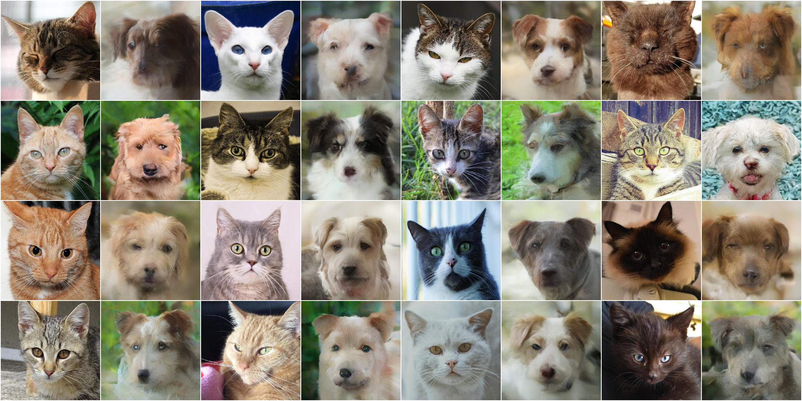
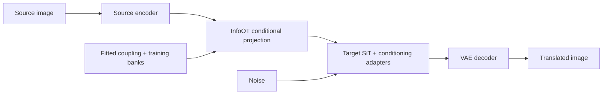

# Diffusion-OT

**Unpaired image translation with diffusion models and information-maximizing optimal transport.**

Diffusion-OT investigates cat ↔ dog translation on AFHQ: generating an image in
the target domain while preserving the source's pose, appearance, and layout,
using only unpaired training images. The PyTorch pipeline connects
image-conditioned diffusion models through information-maximizing optimal
transport (InfoOT).

The repository includes diffusion adaptation, transport fitting, controlled
experiments, and evaluation tools, with saved image galleries and reports.
**Status: research prototype.** Source preservation and target-domain fidelity
remain open research problems.

[Results](#results) · [Overview](#overview) · [Getting started](#getting-started) ·
[Research workflows](guides/research-workflows.md) · [Continuing the project](#continuing-the-project)

## Results



*Read each adjacent pair left to right: original cat → generated dog. These
16 validation examples use the retained CNN v6 checkpoint at 8,000 steps,
EMA weights, conditional-mean projection with bandwidth 0.35, and 20 sampling
steps. The gallery shows transfer behavior alongside blur and correspondence
errors. The default CNN v7 recipe is a separate experiment.*

| Experiment | Images and supporting reports |
| --- | --- |
| Bidirectional CNN-code translation | [Cat → dog](results/v6.5-p0/bandwidth-0.35/translation/cat_to_dog_grid_source_pairs.png), [dog → cat](results/v6.5-p0/bandwidth-0.35/translation/dog_to_cat_grid_source_pairs.png), [evaluation report](results/v6.5-p0/bandwidth-0.35/evaluation_report.json), [protocol](results/v6.5-p0/bandwidth-0.35/evaluation_protocol.json) |
| SigLIP-conditioned SiT-L/2 autoencoder, cat, 30,000 steps | [Reconstruction and shuffled-condition grid](results/pdae_v2_l/30000/step_030000/ema/smoke/reconstruction_grid.png), [smoke report](results/pdae_v2_l/30000/step_030000/ema/smoke/smoke_report.json), [raw/EMA comparison](results/pdae_v2_l/30000/step_030000/raw_ema_comparison.json) |
| Patch-token averaging study (v9) | [Matched comparison grid](results/infoot_vit/averaging_ablation_v9/comparison_grid.png), [experiment report](results/infoot_vit/averaging_ablation_v9/experiment_report.json) |
| Source-latent editing study (v10) | [Matched comparison grid](results/infoot_vit/source_edit_v10/comparison_grid.png), [experiment report](results/infoot_vit/source_edit_v10/experiment_report.json), [runner](infoot_vit/edit_source.py) |
| Additional experiments | [Saved results](results/), including earlier CNN, contrastive, and patch-token transport runs |

Each study has its own protocol; the galleries do not establish a shared
benchmark or a best-performing recipe. The autoencoder grid tests same-domain
conditioning and reconstruction. The transport studies test translation,
including the tradeoff between sharper outputs and copying target references.
Use each report's checkpoint, cohort, and sampling settings when reproducing it.

## Overview

The method first trains a diffusion autoencoder for each domain: an image
encoder supplies the condition, and an adapted diffusion model generates the
image. InfoOT fits a coupling between source and target training representations.
At inference, that coupling maps a new source image's representation into a
condition for the target generator:



Two paths explore this idea: **learned CNN codes**, with joint alignment and
generator adaptation, and **frozen SigLIP 2 patch tokens**, with transport fitted
separately from a trained decoder. Both adapt pretrained SiT diffusion
transformers while keeping the base transformer and VAE frozen.

The implementation covers:

- **Model adaptation:** domain-specific conditioning adapters, image
  cross-attention, and attention LoRA for SiT-B/2 and SiT-L/2.
- **Transport and projection:** fused InfoOT for CNN codes; whole-map,
  grouped-patch, partial, and experimental low-rank transport for patch tokens.
- **Controlled training:** contrastive and decoded-image objectives, spatial
  and appearance costs, and PCGrad for combining task gradients.
- **Experiment tooling:** resumable checkpoints and fits, fixed image IDs and
  noise, raw and exponential-moving-average (EMA) weight comparisons, and
  numerical, gradient, and workflow regression tests.

The default conditional-mean readout averages target representations with
transport-derived weights. This supports unseen source images, but averaging
can soften detail. Retrieved target references help inspect correspondence;
they are not paired ground truth.

## Supported workflows

**Stage 1A** trains the two domain autoencoders independently. **Stage 1B** jointly
trains their encoders, matching heads, and generator adapters for translation.
The SigLIP path uses standalone transport after Stage 1A.

| Workflow | Representation and model | Entry point |
| --- | --- | --- |
| Default Stage 1A → 1B | Learned residual CNN codes; SiT-B/2; cosmap flow weighting; v7 alignment | [Default configurations](src/diffusion_ot/config_defaults.py) and the commands below |
| PDAE v2 / v2-L autoencoders | Frozen SigLIP 2 patch tokens; image cross-attention and LoRA; SiT-B/2 or SiT-L/2 | [SigLIP training and evaluation](guides/research-workflows.md#siglip-conditioned-autoencoders) |
| Standalone patch-token transport | Whole-map, grouped, partial, and low-rank InfoOT with a frozen trained PDAE decoder | [`infoot_vit` guide](infoot_vit/README.md), [low-rank experiments](infoot_vit/lowrank/README.md) |
| Full-bank export → FID/SSIM | Selected compatible CNN-code checkpoint; frozen banks and one global coupling | [Offline alignment and evaluation](guides/research-workflows.md#full-bank-export-and-final-evaluation) |

The quickstart below follows the **CLI default CNN v7 workflow**. To continue the
patch-token experiments, start with the SigLIP and `infoot_vit` guides above.
Version labels are local to each experiment family; patch-token v7 and CNN
Stage 1B v7 refer to different experiments.

**Compatibility matters:** joint Stage 1B training of SigLIP token transport is
not implemented. The standalone `infoot_vit/` inference workflow is available.
Full-bank export currently supports the retained non-spatial recipes and rejects
`spatial_correlative_cost`, including the default v7 recipe.

## Getting started

The documented training environment is **Python 3.10+ on Linux with CUDA**.
Choose a PyTorch build compatible with your GPU. CPU execution supports numerical
checks; the training and image-generation commands below are GPU workloads.
Model weights, datasets, and training checkpoints are prepared separately.

### 1. Install dependencies

```bash
git clone https://github.com/riverside234/diffusion-ot.git
cd diffusion-ot
python -m venv .venv
source .venv/bin/activate
python -m pip install -r requirements.txt
```

The command blocks use Bash syntax. In PowerShell, activate with
`.\.venv\Scripts\Activate.ps1` and put multiline commands on one line.
The dependency file specifies version ranges; preserve the resolved package
versions and CUDA environment with each experiment.

### 2. Configure paths and prepare data

The supplied YAML files contain a lab-specific `project_root`. Set it to your
absolute checkout path in the [data config](configs/data/afhq_huggan.yaml),
[model config](configs/model/sit_b2_256.yaml),
[pretrained config](configs/pretrained/bilisakura_sit_b2_256.yaml), and the chosen
training/evaluation configs. See the [configuration checklist](guides/research-workflows.md#configuration-and-required-artifacts)
for the complete default set.

The SiT-B/2 pretrained config uses `revision: main`; pin an exact Hugging Face
commit when recording an experiment. Run all commands from the repository root:

```bash
python scripts/verify_sit_snapshot.py --download-if-missing
python scripts/download_afhq_dataset.py
python scripts/prepare_afhq.py
python scripts/cache_vae_latents.py --device cuda:0 --batch-size 16
```

Preparation creates deterministic cat/dog training and validation manifests and
caches VAE latents. Keep the original AFHQ images available for image metrics and
RGB-based workflows. The wild domain is excluded from the current cat/dog runs.

### 3. Train and evaluate the default autoencoders

After preparing data, use `--dry-run` to check configuration and dataset paths
before loading SiT. Then train each domain and inspect its reconstruction:

```bash
python scripts/train_pdae_domain.py --domain cat --device cuda:0 --dry-run
python scripts/train_pdae_domain.py --domain dog --device cuda:0 --dry-run

python scripts/train_pdae_domain.py --domain cat --device cuda:0
python scripts/train_pdae_domain.py --domain dog --device cuda:0
python scripts/evaluate_pdae_domain.py --domain cat --device cuda:0 --weights ema
python scripts/evaluate_pdae_domain.py --domain dog --device cuda:0 --weights ema
```

Both training recipes use 50,000 optimizer updates and batch size 64. These
commands run sequentially on one GPU; use the appropriate visible device index
when running domains separately. Training writes to
`outputs/stage1a_cat_rescnn_cosmap` and `outputs/stage1a_dog_rescnn_cosmap`.

The default Stage 1A evaluator runs an **8-image smoke probe**, a separate
inferred-noise round trip, and appearance-statistics diagnostics. The smoke
probe checks generation with correct and shuffled image conditions. The YAML's
`dataset.num_samples` field does not launch a full image benchmark.

### 4. Align the domains and evaluate translation

Review Stage 1A, then set `stage1a.cat.checkpoint` and
`stage1a.dog.checkpoint` in the [v7 training config](configs/stage1b_infoot/self_supervised_infonce_v7_residual_cosmap_sit_b2.yaml)
to the selected numbered `step_NNNNNN.pt` files from those residual-cosmap runs.

```bash
python scripts/train_joint_infoot.py --device-cat cuda:0 --device-dog cuda:0 --dry-run
python scripts/train_joint_infoot.py --device-cat cuda:0 --device-dog cuda:0 --quick-eval
```

The default Stage 1B budget is 8,000 updates, with checkpoints in
`outputs/stage1b_nce_v7_residual_cosmap/checkpoints` and evaluation reports under
`outputs/stage1b_eval_nce_v7_residual_cosmap`. `--quick-eval` evaluates the saved
calibrated step 0 and the final checkpoint with matched settings after training.
To evaluate a saved checkpoint separately:

```bash
python scripts/evaluate_infoot_alignment.py \
  --checkpoint outputs/stage1b_nce_v7_residual_cosmap/checkpoints/latest.pt \
  --device-cat cuda:0 --device-dog cuda:0 --evaluate-step0 --weights ema
```

The paired evaluator uses 224 fitting references and 224 projection targets per
domain, 20 integration steps, and conditional-mean/MAP translation panels. MAP
uses the highest-probability target condition as a comparison to the mean.

Continue either training stage with `--resume latest` and the same domain,
recipe, and device flags. Fresh runs refuse to overwrite an existing latest
checkpoint; architecture or objective changes need a separate experiment and
output directory.

## Repository layout

| Path | Purpose |
| --- | --- |
| [`src/diffusion_ot/`](src/diffusion_ot/) | Models, losses, training, data handling, and evaluation |
| [`scripts/`](scripts/) | Download, preparation, training, evaluation, and checkpoint-screening CLIs |
| [`configs/`](configs/) | Dataset, model, experiment, and evaluation YAMLs |
| [`infoot_vit/`](infoot_vit/) | Standalone frozen SigLIP patch-token transport experiments |
| [`infoot/`](infoot/) | Separate CNN-based bank, fitting, and co-training experiments |
| [`tests/`](tests/) | Numerical, gradient, checkpoint, configuration, and workflow regressions |
| [`results/`](results/) | Committed image galleries and experimental reports |
| [`guides/research-workflows.md`](guides/research-workflows.md) | Detailed protocols, historical recipes, and handoff requirements |

Generated `artifacts/`, `outputs/`, and data caches are excluded from Git.
A clone includes source code and saved result examples; recreating a run also
requires its model and data artifacts.

## Verification

After installing dependencies, run the focused CPU mechanism and workflow checks
without downloading training datasets or pretrained checkpoints:

```bash
python -m pytest -q tests/test_infoot.py tests/test_stage1a_residual_workflow.py tests/test_stage1b_residual_cosmap.py tests/test_offline_stages.py
```

Run `python -m pytest -q` for the full suite. Numerical and CPU integration checks
cover implementation behavior; image-quality conclusions require matched GPU
experiments and inspection of the generated images.

## Continuing the project

Start by reproducing one named experiment on the new machine before changing
its model or objective. Use the current YAMLs and [CLI defaults](src/diffusion_ot/config_defaults.py)
to resolve commands; historical notes may describe earlier recipes.

1. **Record the baseline.** Keep the Git commit, exact training/evaluation YAMLs,
   launch commands, package versions, and selected numbered checkpoints together.
   Record raw/EMA selection, model revisions, data IDs, and noise seeds.
2. **Transfer and verify artifacts.** Follow the
   [handoff inventory](guides/research-workflows.md#handoff-inventory) for model
   snapshots, original images, manifests, caches, checkpoint state, and fitted
   transport banks/plans. These are needed in addition to the committed galleries.
3. **Reproduce the evaluation.** Compare the same cohort and sampling settings.
   For CNN Stage 1B, retain the calibrated step-0 checkpoint. For standalone
   transport, retain the exact mapper, feature-bank identities, and decoder.
4. **Make one controlled change.** Keep the baseline, write to a new output
   directory, run the relevant regression checks, and save matched image grids
   and reports. Review source preservation, target anatomy, texture, and target
   reuse together.

The main research priorities are preserving source structure through conditional
averaging, separating decoder quality from transport quality, validating low-rank
approximations against dense controls, and extending full-bank export to spatial
costs. Source SSIM, learned contrastive scores, and UMAP plots provide partial
diagnostics; none alone establishes successful translation.

## Acknowledgments

This project builds on [InfoOT](https://github.com/chingyaoc/InfoOT),
[SiT](https://github.com/willisma/SiT),
[BiliSakura's SiT Diffusers checkpoints](https://huggingface.co/BiliSakura/SiT-diffusers),
[SigLIP 2](https://huggingface.co/google/siglip2-base-patch16-224), and
[AFHQ](https://huggingface.co/datasets/huggan/AFHQ).
PatchNCE experiments reuse [CUT](https://github.com/taesungp/contrastive-unpaired-translation);
the [vendored source record](src/diffusion_ot/third_party/cut/README.md) and
[InfoOT audit reference](tests/reference/chingyaoc_infoot/README.md) retain
upstream attribution and license information.

The learned matching heads, conditioning adapters, decoded-image objectives,
calibration and diagnostics, and patch-token transport extensions are developed
in this repository.
