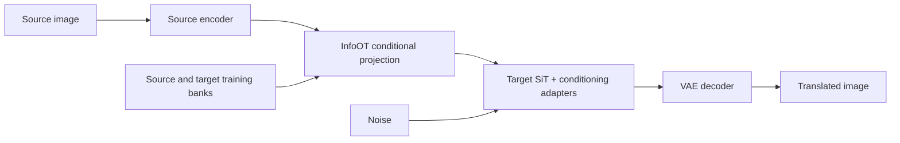

# Diffusion-OT

**Unpaired image translation with diffusion models and information-maximizing optimal transport.**

Diffusion-OT studies how to translate between AFHQ cats and dogs while preserving
source appearance and layout, without paired training images. It combines
image-conditioned diffusion autoencoders with InfoOT: a transport plan connects
source and target representations, and an adapted target-domain diffusion model
generates the translated image.

This repository contains the training pipelines, transport solvers, evaluation
tools, and saved experimental results. **Status: research prototype.** Translation
quality and correspondence remain active research questions.

[Overview](#overview) · [Results](#results) · [Getting started](#getting-started) ·
[Research workflows](guides/research-workflows.md) · [Continuing the project](#continuing-the-project)

## Overview

- **Diffusion adaptation:** domain-specific image conditioning and attention LoRA
  on pretrained SiT-B/2 or SiT-L/2, with the base transformer and VAE frozen.
- **Representation alignment:** learned CNN codes with fused InfoOT, or frozen
  SigLIP 2 patch tokens with standalone balanced and partial transport mappers.
- **Controlled experiments:** contrastive objectives, spatial and appearance
  costs, conditional readouts, and explicit comparisons of raw and EMA weights.
- **Reproducible evaluation:** fixed image IDs and noise, saved configurations,
  resumable fitting, projection diagnostics, and held-out image galleries.

At inference, a source representation is mapped into the target domain and used
to condition generation:



The conditional mean averages target representations using transport-derived
weights. This gives an out-of-sample readout, but averaging can soften details;
a high-probability target reference is a retrieval diagnostic, not paired ground
truth.

## Results


*Retained v6 projection study: adjacent images show the original cat and its
generated dog. This gallery uses the 8,000-step EMA checkpoint and projection
bandwidth 0.35. It illustrates both transfer behavior and remaining softness;
it is separate from the default v7 recipe.*

| Experiment | Images and supporting reports |
| --- | --- |
| Bidirectional CNN-code translation | [Cat → dog](results/v6.5-p0/bandwidth-0.35/translation/cat_to_dog_grid_source_pairs.png), [dog → cat](results/v6.5-p0/bandwidth-0.35/translation/dog_to_cat_grid_source_pairs.png), [evaluation report](results/v6.5-p0/bandwidth-0.35/evaluation_report.json), [protocol](results/v6.5-p0/bandwidth-0.35/evaluation_protocol.json) |
| SigLIP-conditioned SiT-L/2 autoencoder, cat, 30,000 steps | [Reconstruction and shuffled-condition grid](results/pdae_v2_l/30000/step_030000/ema/smoke/reconstruction_grid.png), [smoke report](results/pdae_v2_l/30000/step_030000/ema/smoke/smoke_report.json), [raw/EMA comparison](results/pdae_v2_l/30000/step_030000/raw_ema_comparison.json) |
| Additional experiments | [Saved results](results/), including earlier CNN, contrastive, and patch-token transport runs |

These are experimental examples with different protocols, not a common benchmark.
The autoencoder grid measures same-domain conditioning and reconstruction;
cross-domain translation is evaluated separately. Reports record the actual
cohorts and sampling settings.

## Supported workflows

| Workflow | Representation and model | Entry point |
| --- | --- | --- |
| Default Stage 1A → 1B | Learned residual CNN codes; SiT-B/2; cosmap flow weighting; v7 alignment | [Default configurations](src/diffusion_ot/config_defaults.py) and the commands below |
| PDAE v2 / v2-L autoencoders | Frozen SigLIP 2 patch tokens; image cross-attention and LoRA; SiT-B/2 or SiT-L/2 | [SigLIP training and evaluation](guides/research-workflows.md#siglip-conditioned-autoencoders) |
| Standalone patch-token transport | Whole-map, grouped, partial, and low-rank InfoOT with a frozen trained PDAE decoder | [`infoot_vit` guide](infoot_vit/README.md), [low-rank experiments](infoot_vit/lowrank/README.md) |
| Full-bank export → FID/SSIM | Selected compatible CNN-code checkpoint; frozen banks and one global coupling | [Offline alignment and evaluation](guides/research-workflows.md#full-bank-export-and-final-evaluation) |

**Compatibility matters:** joint Stage 1B training of SigLIP token transport is
not implemented. The standalone `infoot_vit/` inference workflow is available.
Full-bank export currently supports the retained non-spatial recipes and rejects
`spatial_correlative_cost`, including the default v7 recipe.

## Getting started

The documented training environment is **Python 3.10+ on Linux with CUDA**.
Choose a PyTorch build compatible with your GPU environment. CPU execution is
available for numerical checks; training and image-generation experiments require
a practical GPU setup. Model weights, datasets, and training checkpoints are
downloaded or prepared separately.

### 1. Install dependencies

```bash
git clone https://github.com/riverside234/diffusion-ot.git
cd diffusion-ot
python -m venv .venv
source .venv/bin/activate
python -m pip install -r requirements.txt
```

For PowerShell, activate the environment with `.\.venv\Scripts\Activate.ps1`.

### 2. Configure paths and prepare data

The supplied YAML files contain a lab-specific `project_root`. Set it to your
absolute checkout path in the [data config](configs/data/afhq_huggan.yaml),
[model config](configs/model/sit_b2_256.yaml),
[pretrained config](configs/pretrained/bilisakura_sit_b2_256.yaml), and the chosen
training/evaluation configs. See the [configuration checklist](guides/research-workflows.md#configuration-and-required-artifacts)
for the complete default set.

The SiT-B/2 pretrained config uses `revision: main`; pin an exact Hugging Face
commit when recording a reproducible experiment. Then run from the repository root:

```bash
python scripts/verify_sit_snapshot.py --download-if-missing
python scripts/download_afhq_dataset.py
python scripts/prepare_afhq.py
python scripts/cache_vae_latents.py --device cuda:0 --batch-size 16
```

Preparation creates deterministic cat/dog training and validation manifests and
caches VAE latents. Keep the original AFHQ images available for image metrics and
RGB-based workflows. The wild domain is excluded from the current cat/dog runs.

### 3. Train and evaluate the default autoencoders

```bash
python scripts/train_pdae_domain.py --domain cat --device cuda:0
python scripts/train_pdae_domain.py --domain dog --device cuda:0
python scripts/evaluate_pdae_domain.py --domain cat --device cuda:0
python scripts/evaluate_pdae_domain.py --domain dog --device cuda:0
```

Both training recipes use 50,000 optimizer updates and batch size 64. These
commands run sequentially on one GPU; use the appropriate visible device index
when running domains separately. Training writes to
`outputs/stage1a_cat_rescnn_cosmap` and `outputs/stage1a_dog_rescnn_cosmap`.

The default Stage 1A evaluator runs an **8-image smoke probe**, a separate
inferred-noise round trip, and appearance-statistics diagnostics. It does not
launch a full image benchmark from the YAML's `dataset.num_samples` field.

### 4. Align the domains and evaluate translation

Review Stage 1A, then set `stage1a.cat.checkpoint` and
`stage1a.dog.checkpoint` in the [v7 training config](configs/stage1b_infoot/self_supervised_infonce_v7_residual_cosmap_sit_b2.yaml)
to the selected numbered `step_NNNNNN.pt` files from those residual-cosmap runs.

```bash
python scripts/train_joint_infoot.py --quick-eval
python scripts/evaluate_infoot_alignment.py \
  --checkpoint outputs/stage1b_nce_v7_residual_cosmap/checkpoints/latest.pt \
  --evaluate-step0 --weights ema
```

The default Stage 1B budget is 8,000 updates, with outputs in
`outputs/stage1b_nce_v7_residual_cosmap`. The paired evaluator uses 224 fitting
references and 224 projection targets per domain, 20 integration steps, and
conditional-mean/MAP translation panels. `--evaluate-step0` compares against the
saved calibrated initial checkpoint using matched settings.

Use `--dry-run` on either training command to check configuration and dataset
paths before loading SiT. Continue an existing run with `--resume latest` and
the same recipe. Fresh runs refuse to overwrite an existing latest checkpoint;
architecture or objective changes need a separate experiment.

## Repository layout

| Path | Purpose |
| --- | --- |
| [`src/diffusion_ot/`](src/diffusion_ot/) | Models, losses, training, data handling, and evaluation |
| [`scripts/`](scripts/) | Download, preparation, training, evaluation, and checkpoint-screening CLIs |
| [`configs/`](configs/) | Dataset, model, experiment, and evaluation YAMLs |
| [`infoot_vit/`](infoot_vit/) | Standalone frozen SigLIP patch-token transport experiments |
| [`infoot/`](infoot/) | Separate CNN-based bank, fitting, and co-training experiments |
| [`tests/`](tests/) | Numerical, gradient, checkpoint, configuration, and workflow regressions |
| [`results/`](results/) | Committed image galleries and experimental reports |
| [`guides/research-workflows.md`](guides/research-workflows.md) | Detailed protocols, historical recipes, and handoff requirements |

Generated `artifacts/`, `outputs/`, and data caches are excluded from Git.
A clone includes source code and saved result examples; recreating a run also
requires its model and data artifacts.

## Verification

After installing dependencies, run the focused mechanism and workflow checks:

```bash
python -m pytest -q tests/test_infoot.py tests/test_stage1a_residual_workflow.py tests/test_stage1b_residual_cosmap.py tests/test_offline_stages.py
```

Run `python -m pytest -q` for the full suite. Numerical and CPU integration checks
cover implementation behavior; image-quality conclusions require matched GPU
experiments and inspection of the generated images.

## Continuing the project

1. **Choose a workflow and reproduce its baseline.** Keep the exact training and
   evaluation YAMLs, numbered checkpoints, raw/EMA selection, model revisions,
   data IDs, and noise seeds together.
2. **Transfer the required artifacts.** A result gallery alone cannot recreate a
   model. The [handoff inventory](guides/research-workflows.md#handoff-inventory)
   lists the checkpoints, pretrained snapshots, datasets, and calibration state
   needed to continue training or inference.
3. **Use matched comparisons.** Evaluate against saved step 0 and compare source
   appearance, target anatomy, texture, and target reuse. Source SSIM, learned
   contrastive scores, and UMAP plots each measure only part of the behavior.
4. **Address the remaining research gaps.** Study conditional-mean blur and
   correspondence, validate low-rank approximations against dense controls, and
   extend full-bank export to spatial-cost recipes before applying it to v7.

The [research workflow guide](guides/research-workflows.md) preserves the
alternative recipes, evaluation controls, resume rules, and supported export
commands for future contributors.

## Acknowledgments

This project builds on [InfoOT](https://github.com/chingyaoc/InfoOT),
[SiT](https://github.com/willisma/SiT),
[BiliSakura's SiT Diffusers checkpoints](https://huggingface.co/BiliSakura/SiT-diffusers),
[SigLIP 2](https://huggingface.co/google/siglip2-base-patch16-224), and
[AFHQ](https://huggingface.co/datasets/huggan/AFHQ).
PatchNCE experiments reuse [CUT](https://github.com/taesungp/contrastive-unpaired-translation);
the [vendored source record](src/diffusion_ot/third_party/cut/README.md) and
[InfoOT audit reference](tests/reference/chingyaoc_infoot/README.md) retain
upstream attribution and license information.

The learned matching heads, conditioning adapters, decoded-image objectives,
calibration and diagnostics, and patch-token transport extensions are developed
in this repository.
